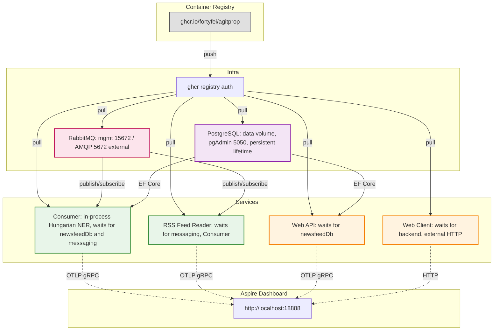

# AgitpropScraper — Architecture

## 1. Overview

AgitpropScraper is a distributed .NET application orchestrated by **Aspire 13.5.4**.
Its service processes share class libraries for scraping, persistence, and NLP.
AppHost-managed services use `Agitprop.ServiceDefaults` for health checks,
instrumentation, and HTTP client resilience; the standalone CLI writes structured
console logs and does not export OTLP telemetry.

Click to expand runtime topology diagram

### Component Table

| # | Project | Kind | Waits for |
|---|---------|------|-----------|
| 1 | **Agitprop.AppHost** | Orchestrator (AppHost.cs) | — |
| 2 | **Agitprop.Testing.AppHost** | Integration-test AppHost | — |
| 3 | **Agitprop.Core** | Class library (interfaces, models, message contract) | — |
| 4 | **Agitprop.Infrastructure** | Class library (spider, HTTP loaders, proxy pool) | — |
| 5 | **Agitprop.Infrastructure.Puppeteer** | Class library (browser loaders) | — |
| 6 | **Agitprop.Scraper.Consumer** | Worker with in-process Hungarian NER | newsfeedDb, messaging |
| 7 | **Agitprop.Scraper.RssFeedReader** | RSS-to-RabbitMQ worker | messaging, consumer |
| 8 | **Agitprop.Scraper.NLPService** | .NET class library (ONNX Runtime, huBERT NER) | — |
| 9 | **Agitprop.Web.Api** | Read-only analytics API | newsfeedDb |
| 10 | **Agitprop.Web.Client** | Blazor Web App (Interactive Server and WebAssembly) | backend (Web.Api) |
| 11 | **Agitprop.CLI** | System.CommandLine operator tool | — |
| 12 | **Agitprop.ServiceDefaults** | Shared library (OTel, health checks, HTTP resilience) | — |
| 13 | **Agitprop.Sinks.Newsfeed** | Parsers, EF Core sink and repositories | — |
| 14 | **Agitprop.Sinks.Newsfeed_Test** | Parser fixture tests | — |
| 15 | **Agitprop.UnitTests** | Unit tests | — |
| 16 | **Agitprop.IntegrationTests** | API/PostgreSQL integration tests | Testing.AppHost |

## 2. Runtime Topology Walkthrough

The request flow follows these steps (see pipelines.md for sequence diagrams):

1. **RSS Feed Reader** (`Agitprop.Scraper.RssFeedReader`) pulls RSS feeds on a timer and publishes
   `NewsfeedJobDescrpition` messages to RabbitMQ (`IPublishEndpoint.PublishBatch`).

2. **Consumer** (`Agitprop.Scraper.Consumer`) consumes jobs from the RabbitMQ queue. For each job
   it builds a `ScrapingJob` (via `ScrapingJobFactory`) and calls `ISpider.CrawlAsync()`.

3. **Spider** (`Agitprop.Infrastructure.Spider`) crawls the URL using `IPageTransport.LoadAsync()`.
   - If `PageCategory == TargetPage`, it runs content parsers and calls `ISink.EmitAsync()`.
   - Otherwise it runs link parsers + pagination to discover new URLs.

4. **Sink** (`Agitprop.Sinks.Newsfeed.NewsfeedSink`) receives the parsed `ContentParserResult`s
   and persists them to PostgreSQL via Entity Framework Core (`AppDbContext`).

5. The sink calls the in-process `NamedEntityRecognizer` in
   `Agitprop.Scraper.NLPService` to extract Hungarian entities from article text.
   There is no NLP HTTP service. The model is downloaded and checksum-verified
   on first use, or loaded from a pre-provisioned directory. Results are stored
   in PostgreSQL.

6. **Web API** (`Agitprop.Web.Api`) serves entity browse and analytics endpoints (cached, 15‑min
   cache for browse, 1‑hour for entity details). Blazor client consumes these endpoints.

7. **CLI** (`Agitprop.CLI`) provides manual operations: `scrape-article`, `scrape-archive`,
   `retry`.

## 3. Dependency Injection Summary

Key registered services (via `ConfigureInfrastructureWithoutBrowser` / `ConfigureInfrastructureWithBrowser`):

| Interface | Implementation | When registered |
|-----------|---------------|-----------------|
| `ISpider` | `Spider` | Always |
| `ICookiesStorage` | `CookieStorage` | Always |
| `IStaticPageLoader` | `HttpStaticPageLoader` | Always |
| `IProxyProvider` | `ProxyScrapeProxyProvider` / `RedScrapeProxyProvider` | When `useProxies=true` |
| `IProxyPool` | `ProxyPool` | When `useProxies=true` |
| `RotatingHttpClientPool` | `RotatingHttpClientPool` | When `useProxies=true` |
| `IPageRequester` | `RotatingProxyPageRequester` / `RespectfulPageRequester` | When `useProxies=true` / default |
| `IBrowserPageLoader` | `PuppeteerPageLoader` / `PuppeteerPageLoaderWithProxies` | When browser mode + proxies |
| `IPageTransport` | Factory combining `IStaticPageLoader` + `IBrowserPageLoader` + `ILogger` | Always |
| `ISink` | `NewsfeedSink` | Always |
| MassTransit endpoints | `NewsfeedJobConsumer` + saga repo (in-memory) | Always |