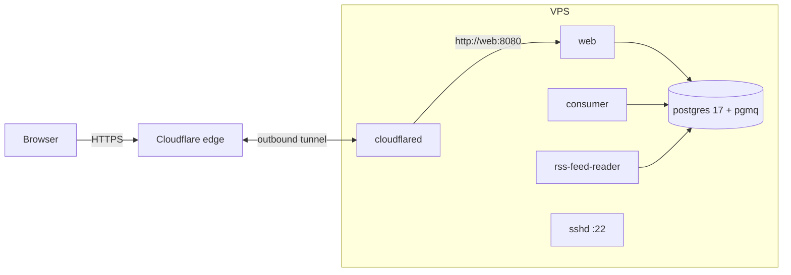

# AgitpropScraper — Deployment

## 1. Aspire Orchestration

The canonical resource graph is defined in
[`Agitprop.AppHost/AppHost.cs`](../Agitprop.AppHost/AppHost.cs):

- PostgreSQL 17 with the PGMQ extension is the shared infrastructure and queue store.
- The consumer and RSS Feed Reader both reference the `newsfeed` database; the reader also waits for the consumer.
- The Web app references PostgreSQL for application data and does not access the queue.
- AppHost-managed services export OTLP telemetry to the Aspire dashboard.

## 2. AppHost

The project provides one canonical AppHost for the full distributed application:

| Project | Use Case | What's included |
|---------|----------|-----------------|
| `Agitprop.AppHost` | Full distributed app | pgmq-enabled postgres + newsfeedDb + consumer (in-process NER) + rss-reader + web + dashboard |

### Run the application:

```bash
# Full app
aspire start --apphost Agitprop.AppHost/Agitprop.AppHost.csproj
```

## 3. Docker & Image Publishing

Images are published to **GHCR** (`ghcr.io/fortyfei/agitprop`) via the Aspire AppHost and GitHub Actions.
No model provisioning step is required at build or publish time: the consumer
container downloads and SHA-256-verifies the pinned Hungarian ONNX model from
Hugging Face automatically the first time it starts, then reuses the local
copy on subsequent restarts. The deployed consumer requires outbound network
access to `huggingface.co` on first start, and can override the model
directory with `NLP__ModelDirectory` (for example, to point at a pre-seeded,
read-only volume in an offline/air-gapped environment).

### Build & Push manually:

```bash
# Login to GHCR
echo $GITHUB_TOKEN | docker login ghcr.io -u fortyfei --password-stdin

# Publish images using the AppHost's configured registry and push workflow
aspire do push
```

### Build the images

Aspire generates a Dockerfile per service at build time, so a manual
`docker build` has nothing to build from in this repository:

```bash
aspire do build     # build every service image
aspire do push      # build and push to the registry configured above
```

## 4. CI/CD Pipeline

### GitHub Actions: `aspire-publish.yml`

The workflow (`.github/workflows/aspire-publish.yml`) runs on push to `main` and:

1. Restores .NET solution.
2. Builds the Aspire application model and image artifacts.
3. Pushes images through `aspire do push`.
4. Pushes images to `ghcr.io/fortyfei/agitprop/*`.

### Environment Variables for CI:

```yaml
env:
  REGISTRY: ghcr.io
  IMAGE_NAMESPACE: fortyfei
  DOCKER_BUILDKIT: 1
```

## 5. Aspire CLI Commands

```bash
# Start the app
aspire start

# Start with isolated mode (randomized ports)
aspire start --isolated

# Watch for changes
aspire start --watch

# Stop the app
aspire stop

# List running AppHosts
aspire ps

# Show resources
aspire resource

# Wait for resources
aspire wait

# View logs
aspire logs

# Open dashboard
aspire dashboard

# Check health
aspire doctor

# Update Aspire CLI
aspire update --self
```

## 6. Production Deployment Checklist

- [ ] `ASPNETCORE_ENVIRONMENT=Production`
- [ ] Connection strings set via environment variables (not appsettings)
- [ ] Migrations: the published stack sets `ApplyMigrationsAtStartup=true`, and migrating an
      up-to-date database is a no-op, so the web container migrates on every start
- [ ] PGMQ extension is installed/enabled and the application role can create the two queues on first startup
- [ ] GHCR credentials configured for image pull
- [ ] Telemetry: the published stack exports nothing by default; set `OTEL_EXPORTER_OTLP_ENDPOINT` only if a collector is part of the deployment
- [ ] PostgreSQL credentials rotated from defaults
- [ ] Proxy providers configured (if using `UseProxies=true`)
- [ ] Health checks accessible for orchestration (k8s liveness/readiness)
- [ ] Persistent volumes for PostgreSQL data
- [ ] Network policies allow PostgreSQL traffic between services

## 7. Kubernetes Deployment (Future)

Aspire supports `Aspire.Hosting.Kubernetes` for k8s manifest generation:

```bash
aspire do --operation publish --output-path ./manifests --project Agitprop.AppHost/Agitprop.AppHost.csproj
```

This generates Kubernetes manifests for all services with proper service discovery and dependencies.

## 8. Cloud Deployment (Azure Container Apps)

Aspire can deploy to Azure Container Apps:

```bash
az containerapp up \
  --resource-group agitprop \
  --environment agitprop-env \
  --image ghcr.io/fortyfei/agitprop/consumer:latest
```

## 9. Health Check Endpoints

| Service | Health Check | Path | Notes |
|---------|-------------|------|-------|
| Web app | ASP.NET health checks | `/health`, `/alive` | Mapped when the environment is Development or `HealthEndpoints:Enabled` is `true`; the published stack sets it |
| PostgreSQL | `pg_isready` | — | Docker health check in the compose file; the app containers wait for `service_healthy` |
| Consumer / RSS reader | — | — | Workers expose no HTTP endpoint and the runtime image ships no HTTP client; watch their logs |

## 10. Cheap Self-Hosted Deployment (single VPS, Cloudflare Tunnel)

The reference topology for a single-user deployment: one 4 GB VPS runs every
container, and the public entry point is a **Cloudflare Tunnel**, so the host has
neither a public IP nor open HTTP ports.



Container budget (measured from the images): postgres 200–300 MB, web
150–250 MB, consumer 600–900 MB (ONNX model), rss-feed-reader ~80 MB,
cloudflared ~30 MB — roughly **1.1–1.6 GB**, which leaves headroom on 4 GB.

The published stack also caps every container with
`deploy.resources.limits.memory`: postgres `1G`, consumer `1200M`, web `512M`,
rss-feed-reader `256M`, cloudflared `128M`. The caps are ceilings, not
reservations, and together they exceed the host's RAM on purpose: a burst in one
container should hit its own limit instead of letting the kernel OOM killer pick
a victim such as PostgreSQL.

### 10.1 Provisioning

- A VPS with ~4 GB RAM, 2 vCPU, Docker Engine and Compose v2, plus 2 GB swap.
- **Firewall: allow only `22`.** The tunnel is an outbound connection, so no
  `80`/`443` rule is needed and no DNS record points at the VPS IP.
- A dedicated operator account owns the deployment, so day-to-day work never
  needs root and the container runtime is not driven by `root`'s Docker config:

  ```bash
  sudo adduser --disabled-password --gecos "" deploy
  sudo usermod -aG docker deploy
  sudo install -d -o deploy -g deploy /opt/agitprop
  sudo install -d -o deploy -g deploy /opt/agitprop/backups
  sudo -iu deploy
  ```

- Images are private, so the deploy user logs in to the registry once. Use a
  token scoped to `read:packages` only; the credentials land in
  `~deploy/.docker/config.json`, which `docker compose pull` (and therefore
  `deploy.sh`) uses:

  ```bash
  echo "$GHCR_TOKEN" | docker login ghcr.io -u <github-user> --password-stdin
  ```

- In the Cloudflare dashboard create a named tunnel and a public hostname for
  `agitprop.cc` whose service is `http://web:8080`; copy the tunnel token into
  `TUNNEL_TOKEN`. A redirect rule can send `www.agitprop.cc` to the apex.
- Optional: a Cloudflare WAF custom rule blocking `/health` and `/alive`, a
  rate-limiting rule on the public hostname, and a health check watching it.
- Optional, later: put SSH itself behind Cloudflare Access
  (`cloudflared access ssh` with an Access application), which allows closing
  port `22`. It is left out of the first bring-up because a mistake there locks
  you out of the host.

### 10.2 Deploy

The deployment bundle is produced by the CI `publish-deployment` job
(`agitprop-deploy` artifact) and contains `docker-compose.yaml` and `.env`. The
`.env` pins each image to the commit the artifact was generated from
(`.../web:<sha>`), so a bundle always describes one exact stack.

```bash
# on the VPS
unzip agitprop-deploy.zip -d agitprop && cd agitprop
chmod +x deploy/*.sh          # the artifact archive does not keep the executable bit
$EDITOR .env                  # fill POSTGRES_PASSWORD, APP_DB_PASSWORD and TUNNEL_TOKEN
chmod 600 .env
docker compose pull
docker compose up -d
```

`.env` carries four required values: `POSTGRES_PASSWORD` (the container
superuser, used only for administration), `APP_DB_PASSWORD` (the role the
application logs in with), `TUNNEL_TOKEN`, and `POSTGRES_BINDMOUNT_0`, which the
CI fills in with the bundle's own `postgres-init` folder. Three optional values
turn on notifications and the off-site copy: `DISCORD_WEBHOOK_URL`,
`ARCHIVE_REPO`, `GH_TOKEN` (see 10.7).

On the first start of an empty data directory PostgreSQL runs
`postgres-init/01-agitprop-role.sql`. It creates the `agitprop` role, the
`newsfeed` database, and the grants the app needs to create and use `pgmq`
queues. The application never runs as the superuser, so a compromised query
cannot reach `COPY ... FROM PROGRAM` and run programs on the database host. The
script runs **once per data volume** — an existing volume keeps its roles, so
create the role by hand (the SQL ships in the bundle) or start from a fresh
volume.

Published stacks apply the EF Core migrations on boot: the web container runs with
`ApplyMigrationsAtStartup=true`, and migrating an up-to-date database is a no-op,
so there is no separate migration step to remember. The workers create the `pgmq`
extension and the `newsfeed_job` / `newsfeed_job_error` queues on their first
start.

The generated stack has **no published ports at all**: the database is reachable
only inside the compose network. Migrations are the web app's job, and the
consumer/rss workers talk to `postgres:5432`.

Start-up order is enforced by Docker, not by retries: `postgres` has a
`pg_isready` health check and every app container depends on it with
`condition: service_healthy`. The web container has its own health check (a TCP
probe on its port, because the runtime image has no `curl`), so `cloudflared`
waits for a listening web app before it opens the tunnel.

**The web port is fixed at `8080`** in the published stack. It must match the
public hostname's service URL in the Cloudflare dashboard (`http://web:8080`);
there is no longer a `WEB_PORT` value to keep in sync in `.env`.

### 10.3 Operations

The bundle ships the operator scripts described in 10.6 and 10.7. The raw
commands below are what those scripts wrap; reach for them when something is
broken.

`pg_hba` in this stack requires the password **even on the container's unix
socket**, so `psql` needs `PGPASSWORD`:

```bash
# logs
docker compose logs -f web consumer rss-feed-reader cloudflared

# shell into the database
set -a; . ./.env; set +a
docker compose exec -e PGPASSWORD="$POSTGRES_PASSWORD" postgres psql -U postgres newsfeed

# deploy a build, with rollback on failure (10.6)
./deploy.sh <commit-sha>

# back up now, and prove the dump restores (10.7)
./backup.sh && ./restore.sh backups/newsfeed-$(date +%F).sql.gz
```

Image tags are commit SHAs, never `latest`, so the only thing a rollback needs is
the SHA that was running. `git log` names it; the images stay in the registry.

Before the first `docker compose up`, check that no value is still empty — the
postgres image fails late and unhelpfully otherwise:

```bash
grep -E '^(POSTGRES_PASSWORD|APP_DB_PASSWORD|TUNNEL_TOKEN|CONSUMER_IMAGE|RSS_FEED_READER_IMAGE|WEB_IMAGE|POSTGRES_BINDMOUNT_0)=$' .env \
  && echo 'fill these values in .env'
```

#### Logs and telemetry

The published stack exports **no telemetry**: the Aspire dashboard is a local
development aid and is excluded from publish mode, and the OTLP exporter is only
registered when `OTEL_EXPORTER_OTLP_ENDPOINT` is set. Everything a service
writes goes to stdout and is read with `docker compose logs -f <service>`. If you
ever want traces and metrics, the services already emit them — add a collector to
the stack and set `OTEL_EXPORTER_OTLP_ENDPOINT` for the services that should
report to it.

`HealthEndpoints__Enabled` is `true` in the published stack, so `/health` and
`/alive` exist in production for an uptime monitor; block those paths at the
Cloudflare edge so they are not public.

```bash
# health of the containers themselves
docker compose ps                                            # web and postgres report healthy
docker compose exec postgres pg_isready -U postgres -d newsfeed
docker compose exec web bash -c 'exec 3<>/dev/tcp/127.0.0.1/8080' && echo listening
```

There is no published port to curl: the web app is reachable only through the
tunnel and from inside the compose network.

### 10.4 Hardening checklist

- **Host**: `ufw` allowing only `22`; SSH key-only (`PasswordAuthentication no`,
  `PermitRootLogin no`), fail2ban, `unattended-upgrades`. 2 GB swap.
- **Database**: no published port; passwords come from `.env` (`chmod 600`). The
  app logs in as `agitprop`, not as the superuser. Administration needs the
  password over the unix socket too:
  `set -a; . ./.env; set +a` then
  `docker compose exec -e PGPASSWORD="$POSTGRES_PASSWORD" postgres psql -U postgres newsfeed`.
- **Data**: two named volumes survive container recreates. `agitprop-postgres-data`
  is pinned by name so that editing the AppHost cannot silently create a second,
  empty database volume and look like data loss. `agitprop-ner-model` holds the
  ~440 MB NER model, so `docker compose pull && docker compose up -d` does not
  re-download it. Docker creates a fresh volume owned by root while the app runs
  as `$APP_UID`, so a one-shot `model-ownership` container chowns the volume
  before the consumer starts; without it the consumer cannot write the model and
  crash-loops.
- **Edge**: Cloudflare terminates TLS (Always Use HTTPS, minimum TLS 1.2, WAF
  managed rules). Optional WAF custom rule: block `/health` and `/alive`. Add a
  Cloudflare rate-limiting rule on the public hostname instead of an app-level
  limiter, because the Blazor Server circuit keeps one long-lived WebSocket.
- **Containers**: every published service runs with
  `restart: unless-stopped` and `security_opt: no-new-privileges:true`; the
  generated images run as the non-root `app` user.
- **Optional extra hardening**: add `read_only: true` plus a `tmpfs: /tmp` to the
  services. Memory limits are already in place (`deploy.resources.limits.memory`:
  postgres `1G`, consumer `1200M`, web `512M`, rss-feed-reader `256M`, cloudflared
  `128M`), and the NER model already lives on the `agitprop-ner-model` volume.
- **Backups**: nightly `pg_dump` (see Operations) with rotation, and one
  restore rehearsal.
- **Image tags**: the CI bundle pins every image to the commit it was built from,
  so a rollback means pointing `.env` at an older SHA.

### 10.5 Local development still uses the dashboard

`aspire start` runs the same topology with the Aspire dashboard on `:18888`,
pgAdmin on `:5050`, and PostgreSQL published on `:5432`. Publish mode drops the
dashboard, publishes no ports, and adds `cloudflared`.

### 10.6 Deploying a build

The CI publishes images tagged with the commit and a bundle (`agitprop-deploy`)
whose `.env` names those tags. Nothing reaches into the server: a deploy is a
manual pull **from** the host, so merging into `main` never changes what is
running by itself.

```bash
# every deploy
cd /opt/agitprop
./deploy/deploy.sh <commit-sha>
```

`./deploy/deploy.sh` rewrites the three image tags, pulls, restarts, and waits for
`web` and `postgres` to report healthy. If the pull fails it leaves `.env`
untouched; if the containers do not start or do not become healthy within four
minutes, it puts the previous tags back and restarts them. The three most recent
previous `.env` files stay in `.deploy-history/`, so a rollback is
`./deploy/deploy.sh <older-sha>`; `./deploy/deploy.sh current` restarts whatever
is pinned now.

**Watchtower is deliberately not part of the stack.** It follows a moving tag,
restarts without approval, and knows nothing about the bundle history a rollback
needs — the three properties this deployment wants. Automatic updates would mean
giving those up.

At the end of a successful deploy the script prunes images that have been unused
for 28 days: SHA-tagged images never become dangling, so they would otherwise
fill the disk one deploy at a time.

If `DISCORD_WEBHOOK_URL` is set in `.env`, every deploy reports success or failure
there, including which tag it rolled back to.

### 10.7 Backups, restore rehearsal, off-site copy

The bundle ships three scripts and a systemd timer:

```bash
./deploy/backup.sh                                        # dump now
./deploy/restore.sh backups/newsfeed-YYYY-MM-DD.sql.gz    # prove it restores
```

`backup.sh` writes `backups/newsfeed-<date>.sql.gz`, keeps the **four** most
recent weekly dumps, and keeps **one archive per month** in `backups/archive/`.
It verifies the gzip stream before reporting success, and notifies Discord on
failure (and on success).

Weekly schedule — `deploy/systemd/agitprop-backup.{service,timer}` runs it every
Sunday at 03:30 with `Persistent=true`, so a run missed while the host was off
happens after boot:

```bash
sudo cp deploy/systemd/agitprop-backup.* /etc/systemd/system/
sudo systemctl daemon-reload
sudo systemctl enable --now agitprop-backup.timer
systemctl list-timers agitprop-backup.timer
```

**Off-site copy.** When `ARCHIVE_REPO` (a *private* repository) and `GH_TOKEN`
(a token with `contents: write` on it) are set, the monthly archive is uploaded
as a release asset on a `db-YYYY-MM` release. Release assets avoid the 100 MB
per-file limit a commit would hit, and nothing else leaves the host. Without those
two values the archive stays on the VPS and the script says so.

**Restore rehearsal.** `restore.sh` restores a dump into a scratch database next
to the live one, prints the article/entity/mention counts, then drops it. Run it
after the first weekly backup and whenever a dump looks suspicious. The dumps
contain public news data only — there are no accounts or credentials in them.