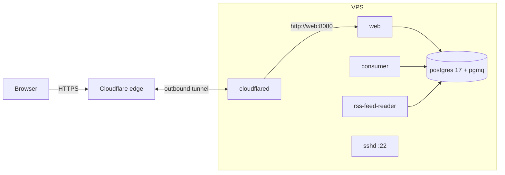

# AgitpropScraper — Deployment

## 1. Aspire Orchestration

The canonical resource graph is defined in
[`Agitprop.AppHost/AppHost.cs`](../Agitprop.AppHost/AppHost.cs):

- PostgreSQL 17 with the PGMQ extension is the shared infrastructure and queue store.
- The consumer and RSS Feed Reader both reference the `newsfeed` database; the reader also waits for the consumer.
- The Web app references PostgreSQL for application data and does not access the queue.
- AppHost-managed services export OTLP telemetry to the Aspire dashboard.

## 2. AppHost

The project provides one canonical AppHost for the full distributed application:

| Project | Use Case | What's included |
|---------|----------|-----------------|
| `Agitprop.AppHost` | Full distributed app | pgmq-enabled postgres + newsfeedDb + consumer (in-process NER) + rss-reader + web + dashboard |

### Run the application:

```bash
# Full app
aspire start --apphost Agitprop.AppHost/Agitprop.AppHost.csproj
```

## 3. Docker & Image Publishing

Images are published to **GHCR** (`ghcr.io/fortyfei/agitprop`) via the Aspire AppHost and GitHub Actions.
No model provisioning step is required at build or publish time: the consumer
container downloads and SHA-256-verifies the pinned Hungarian ONNX model from
Hugging Face automatically the first time it starts, then reuses the local
copy on subsequent restarts. The deployed consumer requires outbound network
access to `huggingface.co` on first start, and can override the model
directory with `NLP__ModelDirectory` (for example, to point at a pre-seeded,
read-only volume in an offline/air-gapped environment).

### Build & Push manually:

```bash
# Login to GHCR
echo $GITHUB_TOKEN | docker login ghcr.io -u fortyfei --password-stdin

# Publish images using the AppHost's configured registry and push workflow
aspire do push
```

### Build a single service image:

```bash
docker build -t agitprop/consumer:latest -f Agitprop.Scraper.Consumer/Dockerfile .
```

## 4. CI/CD Pipeline

### GitHub Actions: `aspire-publish.yml`

The workflow (`.github/workflows/aspire-publish.yml`) runs on push to `main` and:

1. Restores .NET solution.
2. Builds the Aspire application model and image artifacts.
3. Pushes images through `aspire do push`.
4. Pushes images to `ghcr.io/fortyfei/agitprop/*`.

### Environment Variables for CI:

```yaml
env:
  REGISTRY: ghcr.io
  IMAGE_NAMESPACE: fortyfei
  DOCKER_BUILDKIT: 1
```

## 5. Aspire CLI Commands

```bash
# Start the app
aspire start

# Start with isolated mode (randomized ports)
aspire start --isolated

# Watch for changes
aspire start --watch

# Stop the app
aspire stop

# List running AppHosts
aspire ps

# Show resources
aspire resource

# Wait for resources
aspire wait

# View logs
aspire logs

# Open dashboard
aspire dashboard

# Check health
aspire doctor

# Update Aspire CLI
aspire update --self
```

## 6. Production Deployment Checklist

- [ ] `ASPNETCORE_ENVIRONMENT=Production`
- [ ] Connection strings set via environment variables (not appsettings)
- [ ] Migrations: the published stack sets `ApplyMigrationsAtStartup=true`, and migrating an
      up-to-date database is a no-op, so the web container migrates on every start
- [ ] PGMQ extension is installed/enabled and the application role can create the two queues on first startup
- [ ] GHCR credentials configured for image pull
- [ ] OTLP collector endpoint configured (`OTEL_EXPORTER_OTLP_ENDPOINT`)
- [ ] PostgreSQL credentials rotated from defaults
- [ ] Proxy providers configured (if using `UseProxies=true`)
- [ ] Health checks accessible for orchestration (k8s liveness/readiness)
- [ ] Persistent volumes for PostgreSQL data
- [ ] Network policies allow PostgreSQL traffic between services

## 7. Kubernetes Deployment (Future)

Aspire supports `Aspire.Hosting.Kubernetes` for k8s manifest generation:

```bash
aspire do --operation publish --output-path ./manifests --project Agitprop.AppHost/Agitprop.AppHost.csproj
```

This generates Kubernetes manifests for all services with proper service discovery and dependencies.

## 8. Cloud Deployment (Azure Container Apps)

Aspire can deploy to Azure Container Apps:

```bash
az containerapp up \
  --resource-group agitprop \
  --environment agitprop-env \
  --image ghcr.io/fortyfei/agitprop/consumer:latest
```

## 9. Health Check Endpoints

| Service | Health Check | Path | Notes |
|---------|-------------|------|-------|
| Web app | ASP.NET health checks | `/health`, `/alive` | Mapped when the environment is Development or `HealthEndpoints:Enabled` is `true`; the published stack sets it |
| PostgreSQL | `pg_isready` | — | Docker health check in the compose file; the app containers wait for `service_healthy` |
| Consumer / RSS reader | — | — | Workers expose no HTTP endpoint and the runtime image ships no HTTP client; watch their logs |

## 10. Cheap Self-Hosted Deployment (single VPS, Cloudflare Tunnel)

The reference topology for a single-user deployment: one 4 GB VPS runs every
container, and the public entry point is a **Cloudflare Tunnel**, so the host has
neither a public IP nor open HTTP ports.



Container budget (measured from the images): postgres 200–300 MB, web
150–250 MB, consumer 600–900 MB (ONNX model), rss-feed-reader ~80 MB,
cloudflared ~30 MB — roughly **1.1–1.6 GB**, which leaves headroom on 4 GB.

The published stack also caps every container with
`deploy.resources.limits.memory`: postgres `1G`, consumer `1200M`, web `512M`,
rss-feed-reader `256M`, cloudflared `128M`. The caps are ceilings, not
reservations, and together they exceed the host's RAM on purpose: a burst in one
container should hit its own limit instead of letting the kernel OOM killer pick
a victim such as PostgreSQL.

### 10.1 Provisioning

- A VPS with ~4 GB RAM, 2 vCPU, Docker Engine and Compose v2, plus 2 GB swap.
- **Firewall: allow only `22`.** The tunnel is an outbound connection, so no
  `80`/`443` rule is needed and no DNS record points at the VPS IP.
- In the Cloudflare dashboard create a named tunnel and a public hostname
  (for example `agitprop.<domain>`) whose service is `http://web:8080`; copy the
  tunnel token into `TUNNEL_TOKEN`.
- Optional: a Cloudflare WAF custom rule blocking `/health` and `/alive`, and a
  health check that watches the public hostname.

### 10.2 Deploy

The deployment bundle is produced by the CI `publish-deployment` job
(`agitprop-deploy` artifact) and contains `docker-compose.yaml` and `.env`. The
`.env` pins each image to the commit the artifact was generated from
(`.../web:<sha>`), so a bundle always describes one exact stack.

```bash
# on the VPS
unzip agitprop-deploy.zip -d agitprop && cd agitprop
$EDITOR .env                  # fill POSTGRES_PASSWORD, APP_DB_PASSWORD and TUNNEL_TOKEN
chmod 600 .env
docker compose pull
docker compose up -d
```

`.env` carries four values: `POSTGRES_PASSWORD` (the container superuser, used
only for administration), `APP_DB_PASSWORD` (the role the application logs in
with), `TUNNEL_TOKEN`, and `POSTGRES_BINDMOUNT_0`, which the CI fills in with the
bundle's own `postgres-init` folder.

On the first start of an empty data directory PostgreSQL runs
`postgres-init/01-agitprop-role.sql`. It creates the `agitprop` role, the
`newsfeed` database, and the grants the app needs to create and use `pgmq`
queues. The application never runs as the superuser, so a compromised query
cannot reach `COPY ... FROM PROGRAM` and run programs on the database host. The
script runs **once per data volume** — an existing volume keeps its roles, so
create the role by hand (the SQL ships in the bundle) or start from a fresh
volume.

Published stacks apply the EF Core migrations on boot: the web container runs with
`ApplyMigrationsAtStartup=true`, and migrating an up-to-date database is a no-op,
so there is no separate migration step to remember. The workers create the `pgmq`
extension and the `newsfeed_job` / `newsfeed_job_error` queues on their first
start.

The generated stack has **no published ports at all**: the database is reachable
only inside the compose network. Migrations are the web app's job, and the
consumer/rss workers talk to `postgres:5432`.

Start-up order is enforced by Docker, not by retries: `postgres` has a
`pg_isready` health check and every app container depends on it with
`condition: service_healthy`. The web container has its own health check (a TCP
probe on its port, because the runtime image has no `curl`), so `cloudflared`
waits for a listening web app before it opens the tunnel.

**The web port is fixed at `8080`** in the published stack. It must match the
public hostname's service URL in the Cloudflare dashboard (`http://web:8080`);
there is no longer a `WEB_PORT` value to keep in sync in `.env`.

### 10.3 Operations

```bash
# logs
docker compose logs -f web consumer rss-feed-reader cloudflared

# backup (add to cron)
docker compose exec -T postgres pg_dump -U postgres newsfeed | gzip > backup-$(date +%F).sql.gz

# shell into the database
docker compose exec postgres psql -U postgres newsfeed

# update to a newer build: download the agitprop-deploy artifact of that commit
# (the build-and-push job must have finished) and replace .env, then
docker compose pull && docker compose up -d

# roll back: change the three image tags in .env to the commit that last worked
$EDITOR .env && docker compose pull && docker compose up -d
```

Image tags are commit SHAs, never `latest`, so the only thing a rollback needs is
the SHA that was running. `git log` names it; the images stay in the registry.

`HealthEndpoints__Enabled` is `true` in the published stack, so `/health` and
`/alive` exist in production for an uptime monitor; block those paths at the
Cloudflare edge so they are not public.

```bash
# health of the containers themselves
docker compose ps                 # web and postgres report healthy
curl -fsS http://127.0.0.1:8080  # only from inside the compose network
docker compose exec web bash -c 'exec 3<>/dev/tcp/127.0.0.1/8080' && echo listening
```

### 10.4 Hardening checklist

- **Host**: `ufw` allowing only `22`; SSH key-only (`PasswordAuthentication no`,
  `PermitRootLogin no`), fail2ban, `unattended-upgrades`. 2 GB swap.
- **Database**: no published port; passwords come from `.env` (`chmod 600`). The
  app logs in as `agitprop`, not as the superuser; `docker compose exec postgres
  psql -U postgres newsfeed` stays available for administration.
- **Data**: two named volumes survive container recreates. `agitprop-postgres-data`
  is pinned by name so that editing the AppHost cannot silently create a second,
  empty database volume and look like data loss. `agitprop-ner-model` holds the
  ~440 MB NER model, so `docker compose pull && docker compose up -d` does not
  re-download it. Docker creates a fresh volume owned by root while the app runs
  as `$APP_UID`, so a one-shot `model-ownership` container chowns the volume
  before the consumer starts; without it the consumer cannot write the model and
  crash-loops.
- **Edge**: Cloudflare terminates TLS (Always Use HTTPS, minimum TLS 1.2, WAF
  managed rules). Optional WAF custom rule: block `/health` and `/alive`. Add a
  Cloudflare rate-limiting rule on the public hostname instead of an app-level
  limiter, because the Blazor Server circuit keeps one long-lived WebSocket.
- **Containers**: every published service runs with
  `restart: unless-stopped` and `security_opt: no-new-privileges:true`; the
  generated images run as the non-root `app` user.
- **Optional extra hardening**: set `read_only: true` plus a `tmpfs: /tmp` on the
  services, and a memory limit (`deploy.resources.limits.memory`) on `consumer`.
  If you make the consumer read-only, point `NLP__ModelDirectory` at a named
  volume first, because the ONNX model is downloaded on first start.
- **Backups**: nightly `pg_dump` (see Operations) with rotation, and one
  restore rehearsal.
- **Image tags**: the CI bundle currently deploys `:latest`; pin the tag to a
  commit SHA before relying on rollbacks.

### 10.5 Local development still uses the dashboard

`aspire start` runs the same topology with the Aspire dashboard on `:18888`,
pgAdmin on `:5050`, and PostgreSQL published on `:5432`. Publish mode drops the
dashboard, publishes no ports, and adds `cloudflared`.