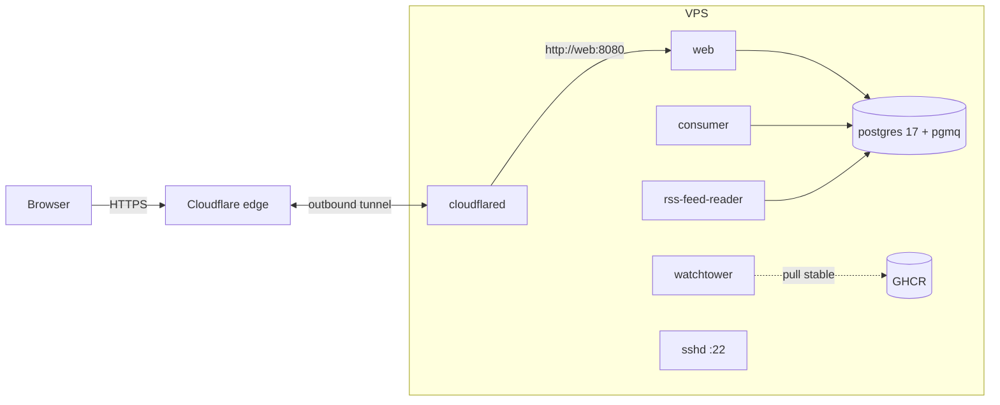

# AgitpropScraper — Deployment

## 1. Aspire Orchestration

The canonical resource graph is defined in
[`Agitprop.AppHost/AppHost.cs`](../Agitprop.AppHost/AppHost.cs):

- PostgreSQL 17 with the PGMQ extension is the shared infrastructure and queue store.
- The consumer and RSS Feed Reader both reference the `newsfeed` database; the reader also waits for the consumer.
- The Web app references PostgreSQL for application data and does not access the queue.
- AppHost-managed services export OTLP telemetry to the Aspire dashboard.

## 2. AppHost

The project provides one canonical AppHost for the full distributed application:

| Project | Use Case | What's included |
|---------|----------|-----------------|
| `Agitprop.AppHost` | Full distributed app | pgmq-enabled postgres + newsfeedDb + consumer (in-process NER) + rss-reader + web + dashboard |

### Run the application:

```bash
# Full app
aspire start --apphost Agitprop.AppHost/Agitprop.AppHost.csproj
```

## 3. Docker & Image Publishing

Images are published to **GHCR** (`ghcr.io/fortyfei/agitprop`) via the Aspire AppHost and GitHub Actions.
No model provisioning step is required at build or publish time: the consumer
container downloads and SHA-256-verifies the pinned Hungarian ONNX model from
Hugging Face automatically the first time it starts, then reuses the local
copy on subsequent restarts. The deployed consumer requires outbound network
access to `huggingface.co` on first start, and can override the model
directory with `NLP__ModelDirectory` (for example, to point at a pre-seeded,
read-only volume in an offline/air-gapped environment).

### Build & Push manually:

```bash
# Login to GHCR
echo $GITHUB_TOKEN | docker login ghcr.io -u fortyfei --password-stdin

# Publish images using the AppHost's configured registry and push workflow
aspire do push
```

### Build the images

Aspire generates a Dockerfile per service at build time, so a manual
`docker build` has nothing to build from in this repository:

```bash
aspire do build     # build every service image
aspire do push      # build and push to the registry configured above
```

## 4. CI/CD Pipeline

### GitHub Actions: `aspire-publish.yml`

Pull requests run the two test jobs. A push to `main` additionally runs the release jobs
in this order:

1. `test` and `integration-tests` — the deterministic unit tests and the Aspire
   integration tests; everything below waits for them.
2. `build-and-push` — `aspire do push` builds and pushes every image under its commit
   SHA, then moves the `stable` tag onto those images with `docker buildx imagetools
   create`.
3. `publish-deployment` — `aspire publish` generates `docker-compose.yaml` and `.env`,
   the AppHost's `postgres-init` script is copied next to them, the `.env` is filled with
   the `stable` image names and the two bind-mount sources, and the commit is written to
   `.build-sha`. The result is uploaded as the `agitprop-deploy` artifact.

The artifact upload must keep `include-hidden-files: true`: `.env` and `.build-sha`
are dotfiles, and `actions/upload-artifact` drops them silently otherwise.

### Environment Variables for CI:

```yaml
env:
  # Pinned Aspire CLI used by the build and publish jobs.
  ASPIRE_CLI_VERSION: 13.6.5
```

## 5. Aspire CLI Commands

```bash
# Start the app
aspire start

# Start with isolated mode (randomized ports)
aspire start --isolated

# Watch for changes
aspire start --watch

# Stop the app
aspire stop

# List running AppHosts
aspire ps

# Show resources
aspire resource

# Wait for resources
aspire wait

# View logs
aspire logs

# Open dashboard
aspire dashboard

# Check health
aspire doctor

# Update Aspire CLI
aspire update --self
```

## 6. Production Deployment Checklist

- [ ] `ASPNETCORE_ENVIRONMENT=Production`
- [ ] Connection strings set via environment variables (not appsettings)
- [ ] Migrations: the published stack sets `ApplyMigrationsAtStartup=true`, and migrating an
      up-to-date database is a no-op, so the web container migrates on every start
- [ ] PGMQ extension is installed/enabled and the application role can create the two queues on first startup
- [ ] GHCR credentials configured for image pull
- [ ] Telemetry: the published stack exports nothing by default; set `OTEL_EXPORTER_OTLP_ENDPOINT` only if a collector is part of the deployment
- [ ] PostgreSQL credentials rotated from defaults
- [ ] Proxy providers configured (if using `UseProxies=true`)
- [ ] Health checks accessible for orchestration (k8s liveness/readiness)
- [ ] Persistent volumes for PostgreSQL data
- [ ] Network policies allow PostgreSQL traffic between services

## 7. Kubernetes Deployment (Future)

Aspire supports `Aspire.Hosting.Kubernetes` for k8s manifest generation:

```bash
aspire do --operation publish --output-path ./manifests --project Agitprop.AppHost/Agitprop.AppHost.csproj
```

This generates Kubernetes manifests for all services with proper service discovery and dependencies.

## 8. Cloud Deployment (Azure Container Apps)

Aspire can deploy to Azure Container Apps:

```bash
az containerapp up \
  --resource-group agitprop \
  --environment agitprop-env \
  --image ghcr.io/fortyfei/agitprop/consumer:latest
```

## 9. Health Check Endpoints

| Service | Health Check | Path | Notes |
|---------|-------------|------|-------|
| Web app | ASP.NET health checks | `/health`, `/alive` | Mapped when the environment is Development or `HealthEndpoints:Enabled` is `true`; the published stack sets it |
| PostgreSQL | `pg_isready` | — | Docker health check in the compose file; the app containers wait for `service_healthy` |
| Consumer / RSS reader | — | — | Workers expose no HTTP endpoint and the runtime image ships no HTTP client; watch their logs |

## 10. Cheap Self-Hosted Deployment (single VPS, Cloudflare Tunnel)

The reference topology for a single-user deployment: one 4 GB VPS runs every
container, and the public entry point is a **Cloudflare Tunnel**, so the host has
neither a public IP nor open HTTP ports.



Container budget (measured from the images): postgres 200–300 MB, web
150–250 MB, consumer 600–900 MB (ONNX model), rss-feed-reader ~80 MB,
cloudflared ~30 MB, watchtower ~20 MB — roughly **1.1–1.6 GB**, which leaves
headroom on 4 GB.

The published stack also caps every container with
`deploy.resources.limits.memory`: postgres `1G`, consumer `1200M`, web `512M`,
rss-feed-reader `256M`, cloudflared `128M`, watchtower `64M`. The caps are
ceilings, not reservations, and together they exceed the host's RAM on purpose: a
burst in one container should hit its own limit instead of letting the kernel OOM
killer pick a victim such as PostgreSQL.

### 10.1 Provisioning

- A VPS with ~4 GB RAM, 2 vCPU, Docker Engine and Compose v2, plus 2 GB swap.
- **Firewall: allow only `22`.** The tunnel is an outbound connection, so no
  `80`/`443` rule is needed and no DNS record points at the VPS IP.
- A dedicated operator account owns the deployment, so day-to-day work never
  needs root and the container runtime is not driven by `root`'s Docker config:

  ```bash
  sudo adduser --disabled-password --gecos "" deploy
  sudo usermod -aG docker deploy
  sudo install -d -o deploy -g deploy /opt/agitprop
  sudo -iu deploy
  ```

- Images are private, so the deploy user logs in to the registry once. Use a
  token scoped to `read:packages` only; the credentials land in
  `~deploy/.docker/config.json`, which is what both `docker compose pull` and
  Watchtower use:

  ```bash
  echo "$GHCR_TOKEN" | docker login ghcr.io -u <github-user> --password-stdin

  # Watchtower reads the same login from a directory, so it must be copied there
  # (read-only mount, path fixed in the published compose file)
  mkdir -p /opt/agitprop/docker-config
  cp ~/.docker/config.json /opt/agitprop/docker-config/config.json
  chmod 700 /opt/agitprop/docker-config
  chmod 600 /opt/agitprop/docker-config/config.json
  ```

  A token that expires means two things to redo: `docker login` again and copy
  the file again. First the app containers lose the ability to pull, then
  Watchtower stops updating. Watchtower picks a changed file up on its next poll;
  no restart is needed.

- In the Cloudflare dashboard create a named tunnel and a public hostname for
  `agitprop.cc` whose service is `http://web:8080`; copy the tunnel token into
  `TUNNEL_TOKEN`. A redirect rule can send `www.agitprop.cc` to the apex.
- Optional: a Cloudflare WAF custom rule blocking `/health` and `/alive`, a
  rate-limiting rule on the public hostname, and a health check watching it.
- Optional, later: put SSH itself behind Cloudflare Access
  (`cloudflared access ssh` with an Access application), which allows closing
  port `22`. It is left out of the first bring-up because a mistake there locks
  you out of the host.

### 10.2 Deploy

The deployment bundle is produced by the CI `publish-deployment` job
(`agitprop-deploy` artifact) and contains `docker-compose.yaml`, `.env` and
`postgres-init/`. The `.env` names the images by the moving `stable` tag;
`postgres`, `cloudflared` and `model-ownership` stay pinned to exact versions, and
the commit the bundle was generated from is recorded in `.build-sha`.

```bash
# on the VPS
unzip agitprop-deploy.zip -d agitprop && cd agitprop
$EDITOR .env                  # fill POSTGRES_PASSWORD, APP_DB_PASSWORD and TUNNEL_TOKEN
chmod 600 .env
docker compose pull
docker compose up -d
```

`.env` carries five required values: `POSTGRES_PASSWORD` (the container
superuser, used only for administration), `APP_DB_PASSWORD` (the role the
application logs in with), `TUNNEL_TOKEN`, and the two bind-mount sources
`POSTGRES_BINDMOUNT_0` and `WATCHTOWER_BINDMOUNT_0`, which the CI fills in.

On the first start of an empty data directory PostgreSQL runs
`postgres-init/01-agitprop-role.sql`. It creates the `agitprop` role, the
`newsfeed` database, and the grants the app needs to create and use `pgmq`
queues. The application never runs as the superuser, so a compromised query
cannot reach `COPY ... FROM PROGRAM` and run programs on the database host. The
script runs **once per data volume** — an existing volume keeps its roles, so
create the role by hand (the SQL ships in the bundle) or start from a fresh
volume.

Published stacks apply the EF Core migrations on boot: the web container runs with
`ApplyMigrationsAtStartup=true`, and migrating an up-to-date database is a no-op,
so there is no separate migration step to remember. The workers create the `pgmq`
extension and the `newsfeed_job` / `newsfeed_job_error` queues on their first
start. The same boot seeds the curated entity catalog (`EntityCatalogSeeder`, also
run by the consumer), so canonical names, types and aliases exist before the first
article is processed.

Entity identity lives in `entities` (`Source` is `catalog` or `observed`) and
`entity_aliases`. The catalog seeder folds an observed entity into the catalog
entity when the surface form denotes exactly one catalog entity — including when
the NER label drifted to another type — and leaves homographs alone. It locks the
shadow row (`FOR UPDATE`) and moves the mentions with a single `DELETE …
RETURNING` + `INSERT … ON CONFLICT` statement, so a consumer writing at the same
time cannot lose a mention or break the entity delete.

To rebuild entity data without touching the curated catalog:

```sql
TRUNCATE articles CASCADE;           -- mentions are removed with their articles
DELETE FROM entities WHERE "Source" = 'observed';
```

Then let the scraper re-fill the tables. Catalog entities and their aliases stay
in place, and the write path re-links the new surface forms against them.

The generated stack has **no published ports at all**: the database is reachable
only inside the compose network. Migrations are the web app's job, and the
consumer/rss workers talk to `postgres:5432`.

Start-up order is enforced by Docker, not by retries: `postgres` has a
`pg_isready` health check and every app container depends on it with
`condition: service_healthy`. The web container has its own health check (a TCP
probe on its port, because the runtime image has no `curl`), so `cloudflared`
waits for a listening web app before it opens the tunnel.

**The web port is fixed at `8080`** in the published stack. It must match the
public hostname's service URL in the Cloudflare dashboard (`http://web:8080`);
there is no longer a `WEB_PORT` value to keep in sync in `.env`.

### 10.3 Operations

The raw commands below are what the operations in 10.6 and 10.7 wrap; reach for
them when something is broken.

`pg_hba` in this stack requires the password **even on the container's unix
socket**, so `psql` needs `PGPASSWORD`:

```bash
# logs
docker compose logs -f web consumer rss-feed-reader cloudflared

# shell into the database
set -a; . ./.env; set +a
docker compose exec -e PGPASSWORD="$POSTGRES_PASSWORD" postgres psql -U postgres newsfeed
```

Image tags are commit SHAs plus the moving `stable` tag; nothing is `latest`, so
a rollback can always name an exact build. The rest of the deploy story — what
Watchtower does, and the two commands that pin or unpin it — is in 10.6.

Before the first `docker compose up`, check that no value is still empty — the
postgres image fails late and unhelpfully otherwise:

```bash
grep -E '^(POSTGRES_PASSWORD|APP_DB_PASSWORD|TUNNEL_TOKEN|CONSUMER_IMAGE|RSS_FEED_READER_IMAGE|WEB_IMAGE|POSTGRES_BINDMOUNT_0|WATCHTOWER_BINDMOUNT_0)=$' .env \
  && echo 'fill these values in .env'
```

#### Logs and telemetry

The published stack exports **no telemetry**: the Aspire dashboard is a local
development aid and is excluded from publish mode, and the OTLP exporter is only
registered when `OTEL_EXPORTER_OTLP_ENDPOINT` is set. Everything a service
writes goes to stdout and is read with `docker compose logs -f <service>`. If you
ever want traces and metrics, the services already emit them — add a collector to
the stack and set `OTEL_EXPORTER_OTLP_ENDPOINT` for the services that should
report to it.

`HealthEndpoints__Enabled` is `true` in the published stack, so `/health` and
`/alive` exist in production for an uptime monitor; block those paths at the
Cloudflare edge so they are not public.

```bash
# health of the containers themselves
docker compose ps                                            # web and postgres report healthy
docker compose exec postgres pg_isready -U postgres -d newsfeed
docker compose exec web bash -c 'exec 3<>/dev/tcp/127.0.0.1/8080' && echo listening
```

There is no published port to curl: the web app is reachable only through the
tunnel and from inside the compose network.

### 10.4 Hardening checklist

- **Host**: `ufw` allowing only `22`; SSH key-only (`PasswordAuthentication no`,
  `PermitRootLogin no`), fail2ban, `unattended-upgrades`. 2 GB swap.
- **Database**: no published port; passwords come from `.env` (`chmod 600`). The
  app logs in as `agitprop`, not as the superuser. Administration needs the
  password over the unix socket too:
  `set -a; . ./.env; set +a` then
  `docker compose exec -e PGPASSWORD="$POSTGRES_PASSWORD" postgres psql -U postgres newsfeed`.
- **Data**: two named volumes survive container recreates. `agitprop-postgres-data`
  is pinned by name so that editing the AppHost cannot silently create a second,
  empty database volume and look like data loss. `agitprop-ner-model` holds the
  ~440 MB NER model, so `docker compose pull && docker compose up -d` does not
  re-download it. Docker creates a fresh volume owned by root while the app runs
  as `$APP_UID`, so a one-shot `model-ownership` container chowns the volume
  before the consumer starts; without it the consumer cannot write the model and
  crash-loops.
- **Edge**: Cloudflare terminates TLS (Always Use HTTPS, minimum TLS 1.2, WAF
  managed rules). Optional WAF custom rule: block `/health` and `/alive`. Add a
  Cloudflare rate-limiting rule on the public hostname instead of an app-level
  limiter, because the Blazor Server circuit keeps one long-lived WebSocket.
- **Containers**: every published service runs with
  `restart: unless-stopped` and `security_opt: no-new-privileges:true`; the
  generated images run as the non-root `app` user. The four services that never
  need a privileged operation (`web`, `consumer`, `rss-feed-reader`,
  `cloudflared`) also drop every Linux capability with `cap_drop: ALL`; `postgres`
  keeps its defaults because the entrypoint needs them to fix ownership of a fresh
  data directory. The app services pin `ASPNETCORE_ENVIRONMENT` /
  `DOTNET_ENVIRONMENT` to `Production` explicitly instead of relying on the
  framework default.
- **Optional extra hardening**: add `read_only: true` to the services that write
  nothing. `rss-feed-reader` and `cloudflared` are the safe ones; `web` needs a
  `tmpfs` for `/tmp` and for `/home/app/.aspnet`, where ASP.NET Core keeps the
  DataProtection keys that antiforgery relies on; `postgres` needs
  `/var/run/postgresql` and `/tmp` writable. Memory limits are already in place
  (`deploy.resources.limits.memory`: postgres `1G`, consumer `1200M`, web `512M`,
  rss-feed-reader `256M`, cloudflared `128M`), and the NER model already lives on
  the `agitprop-ner-model` volume.
- **Consumer memory**: `ConcurrencyLimit` (4 by default) is the knob if the
  consumer approaches its `1200M` limit — each concurrent article goes through the
  ONNX session. Lower it to 2 before raising the limit.
- **Backups**: **not automated yet** — see 10.7. Until that is in place, keep a
  manual dump before anything that changes the schema.
- **Image tags**: every image is published under its commit SHA and the moving `stable` tag is
  moved onto each build. Watchtower follows `stable`; pinning a commit in `.env` stops automatic
  updates until `stable` is put back (see 10.6).

### 10.5 Local development still uses the dashboard

`aspire start` runs the same topology with the Aspire dashboard on `:18888`,
pgAdmin on `:5050`, and PostgreSQL published on `:5432`. Publish mode drops the
dashboard, publishes no ports, and adds `cloudflared`.

### 10.6 Deploying a build

**Merging into `main` deploys itself.** The pipeline publishes every image under
its commit SHA, moves the moving `stable` tag onto that build, and produces the
bundle. On the host, Watchtower polls the registry every five minutes and
recreates the three labelled app containers (`web`, `consumer`,
`rss-feed-reader`) when `stable` points at a new digest. Nothing reaches into the
server; the approval step is the pull request merge.

Watchtower does **not** wait for health and cannot roll back. What still protects
a bad merge:

- the container health checks make a broken web app visible (`docker compose ps`
  shows `unhealthy`) instead of silently serving errors;
- a revert PR merged into `main` moves `stable` back, and Watchtower deploys the
  revert the same way — no shell needed;
- pinning a commit in `.env` is the emergency brake: keep the automatic channel
  aside, then pin, then hand the stack back when the trouble is over.

```bash
cd /opt/agitprop

# freeze at one build (any commit SHA from `git log`)
cp .env .env.stable
sed -i 's|:stable$|:<commit-sha>|' .env
docker compose pull && docker compose up -d

# hand the stack back to Watchtower
cp .env.stable .env
docker compose pull && docker compose up -d
```

The bundle names all three app images with `stable`, so one substitution covers
them, and `.env.stable` is what makes the way back a single `cp`. Containers
created on a SHA tag watch that tag, whose digest never changes, which is exactly
why the pin holds until you undo it.

Watchtower restarts in `--rolling-restart` mode: one container at a time, and for
`web` — which declares a health check — the old container is only stopped once the
new one reports healthy, so migrations finish before traffic moves.

Watchtower is the only container with the Docker socket mounted, which is
root-equivalent on this host. `--label-enable` keeps it from touching `postgres`,
`cloudflared` and the one-shot `model-ownership`. The label lives on the three app
services in `AppHost.cs`; `--cleanup` removes the images it replaces, so
SHA-tagged images do not accumulate one deploy at a time.

Watchtower pulls with the registry login the deploy user performed, read from
`/opt/agitprop/docker-config` (mounted read-only at `/config`, `DOCKER_CONFIG`
pointing there). Without that copy it silently fails to pull and only logs
`unauthorized` — the first place to look when a merge does not show up on the
site.

The image is the maintained `nickfedor/watchtower` fork, not
`containrrr/watchtower`. The last containrrr release, 1.7.1, negotiates Docker
API 1.25, and Docker Engine 29 — what `get.docker.com` now installs — rejects
anything below 1.44, so that container exited with code 1 on every boot:

```
Error response from daemon: client version 1.25 is too old.
Minimum supported API version is 1.44, please upgrade your client to a newer version
```

The fork ships a current Docker client and negotiates the API version itself, so
no `DOCKER_API_VERSION` override is needed. Its flags match the ones used here;
`--stop-timeout` is documented as a duration and written `120s` in `AppHost.cs`,
though a bare number still means seconds.

Automatic updates are visible in `docker compose logs -f watchtower`.

One caveat after any restart of `web` (Watchtower or manual): `cloudflared` may
hold a connection to the previous container's address, which shows up as a few
502s. If it does not clear within a minute,
`docker compose restart cloudflared`.

### 10.7 Backups — not automated yet

The published stack has **no scheduled backup**. `agitprop-postgres-data` is the
only copy of the database, so a manual dump is the only safety net until this is
designed properly (it is a separate, planned piece of work).

Take one before anything that can change the schema — an ordinary deploy is safe,
because migrating an up-to-date database is a no-op and a bad release is rolled
back through the image tag:

```bash
cd /opt/agitprop
set -a; . ./.env; set +a
docker compose exec -T -e PGPASSWORD="$POSTGRES_PASSWORD" postgres \
  pg_dump --username postgres --dbname newsfeed \
  | gzip > newsfeed-$(date +%F).sql.gz
gzip --test newsfeed-$(date +%F).sql.gz && echo OK
```

`PGPASSWORD` is required even on the container's unix socket, because
`pg_hba` is configured with `--auth-local=scram-sha-256`.

Restoring is the same shape, into a scratch database next to the live one, so a
bad dump cannot damage production:

```bash
q() { docker compose exec -T -e PGPASSWORD="$POSTGRES_PASSWORD" postgres psql -U postgres "$@"; }

q -c 'DROP DATABASE IF EXISTS newsfeed_restore'
q -c 'CREATE DATABASE newsfeed_restore'
gunzip -c newsfeed-YYYY-MM-DD.sql.gz | q -d newsfeed_restore -q -v ON_ERROR_STOP=1
q -d newsfeed_restore -tAc "SELECT count(*) FROM articles"
q -c 'DROP DATABASE newsfeed_restore'
```

Retention, the off-site copy and scheduling land with that planned work; nothing
in the current bundle does them.