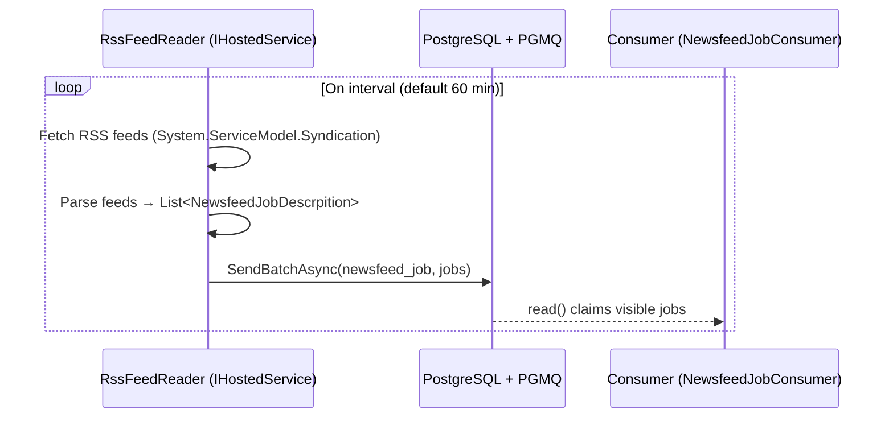
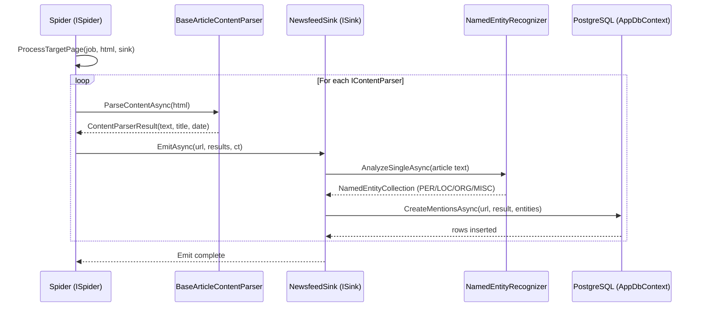
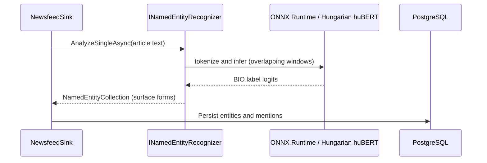
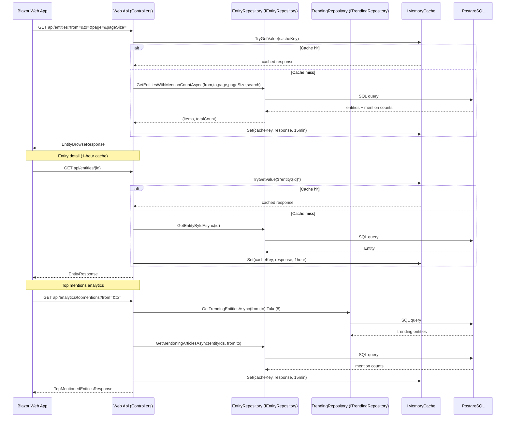
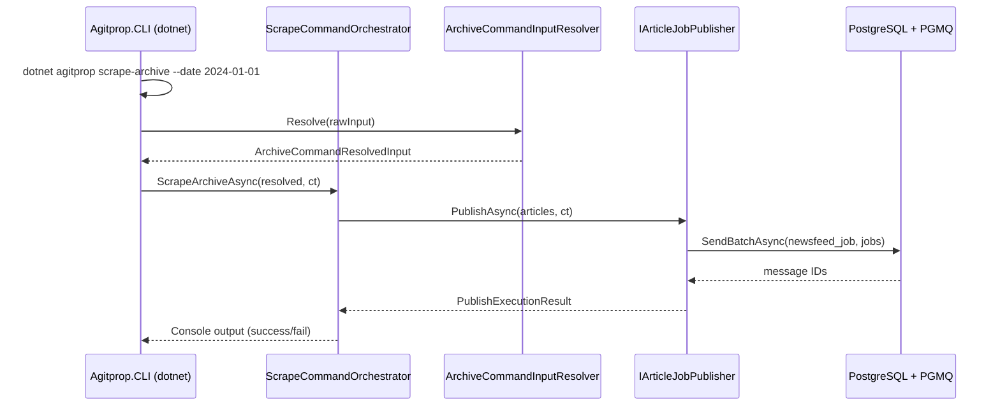
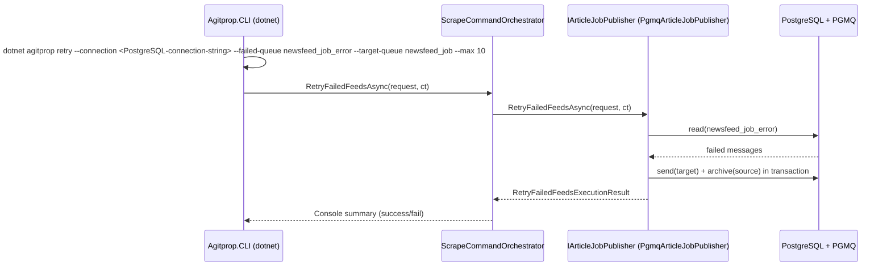

# AgitpropScraper — Pipelines

This document contains **Mermaid sequence diagrams** for every major pipeline in
the system, plus a step-by-step runtime walkthrough.

---

## 1. RSS Feed → Queue Pipeline



## 2. Job Consumption → Spider Crawl Pipeline

```mermaid
sequenceDiagram
    participant MQ as PostgreSQL + PGMQ
    participant CON as NewsfeedJobConsumer
    participant FACT as ScrapingJobFactory
    participant SPIDER as Spider (ISpider)
    participant TRANSPORT as PageTransport (IPageTransport)
    participant BROWSER as Puppeteer (optional)
    participant HTTP as HttpStaticPageLoader

    MQ->>CON: read(newsfeed_job, vt) claims job
    CON->>FACT: GetArticleScrapingJob(source, url)
    FACT-->>CON: ScrapingJob (ContentParsers, LinkParsers, Paginator)
    CON->>SPIDER: CrawlAsync(job, sink, ct)
    SPIDER->>TRANSPORT: LoadAsync(url, PageLoadOptions)
    alt RequiresJavaScript=true
        TRANSPORT->>BROWSER: LoadAsync(url, pageActions, headless)
        BROWSER-->>TRANSPORT: string content
    else Direct HTTP
        TRANSPORT->>HTTP: Load(url)
        HTTP-->>TRANSPORT: string content
    end
    TRANSPORT-->>SPIDER: PageLoadResult(content, url, strategy, duration)
```



## 3. Target Page Parsing → Sink Pipeline



## 4. Link Discovery & Pagination Pipeline

```mermaid
sequenceDiagram
    participant SPIDER as Spider (ISpider)
    participant LINK as ILinkParser
    participant PAGINATOR as IPaginator
    participant CON as NewsfeedJobConsumer
    participant MQ as PostgreSQL + PGMQ

    SPIDER->>SPIDER: ProcessPage(job, html)
    loop For each ILinkParser
        SPIDER->>LINK: GetLinksAsync(baseUrl, doc)
        LINK-->>SPIDER: List<ScrapingJobDescription>
    end
    SPIDER->>PAGINATOR: GetNextPageAsync(currentUrl, doc)
    PAGINATOR-->>SPIDER: next ScrapingJobDescription
    SPIDER-->>CON: return discovered jobs
    CON->>MQ: SendBatchAsync(newsfeed_job, new jobs)
```

## 5. In-Process NLP Pipeline



## 6. Web API → Blazor Client Pipeline



## 7. CLI Pipeline (scrape-archive)



## 8. CLI Retry Pipeline



---

## Runtime Step-by-Step Walkthrough

### Step 1: Aspire Startup

```
aspire start --apphost Agitprop.AppHost/Agitprop.AppHost.csproj
```

1. **AppHost** creates the `DistributedApplication` builder.
2. Registers the container registry `ghcr.io/fortyfei/agitprop` (via `WithEnvironmentAwareImagePush`).
3. Creates the docker-compose environment `agitprop` with:
   - **Dashboard** on `:18888`
   - **PostgreSQL 17 + PGMQ** (`postgres`) — data volume, pgAdmin `:5050`, persistent lifetime, OTLP
   - **Database** `newsfeed` attached to PostgreSQL
   - **Consumer**, **RSS Feed Reader**, **Web API**, **Web Client** projects
4. Each service waits only for its declared dependencies (see component table in architecture.md).

### Step 2: Service Startup Order

1. **PostgreSQL** + **Database** start first.
2. **Consumer** waits for `newsfeedDb`, provisions or loads the Hungarian ONNX model, creates the PGMQ extension and queues, then starts its polling worker.
3. **RSS Feed Reader** waits for `newsfeedDb` and `Consumer`. Registers as `IHostedService`.
5. **Web API** waits for `newsfeedDb`. Applies migrations at startup when configured, then maps controllers.
6. **Web Client** waits for backend (Web API). The Blazor host supports Interactive Server and WebAssembly rendering.

### Step 3: Runtime Operation

1. **RSS Feed Reader** fetches feeds on interval → `IPgmqClient.SendBatchAsync`.
2. **Consumer** claims messages from `newsfeed_job` → `ScrapingJobFactory.GetArticleScrapingJob` → `ISpider.CrawlAsync`.
3. **Spider** uses `IPageTransport.LoadAsync` → `HttpStaticPageLoader` (or `PuppeteerPageLoader` if browser mode).
4. **BaseArticleContentParser** extracts date/title/lead/article via XPath fallback lists.
5. **NewsfeedSink** calls the in-process `NamedEntityRecognizer`, then persists results to PostgreSQL via `AppDbContext.CreateMentionsAsync`.
6. **NamedEntityRecognizer** runs the local ONNX NER model and returns a `NamedEntityCollection`.
7. **Web API** serves entity browse/analytics from PostgreSQL (cached 15 min / 1 hour).
8. **CLI** can re-queue failed messages from `newsfeed_job_error` via the `retry` command.